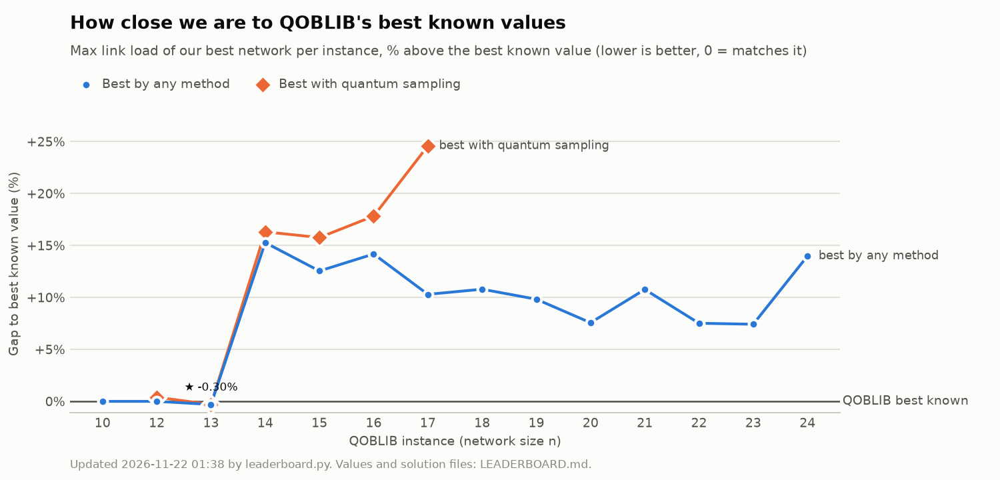

# Leaderboard: QOBLIB 08 network design (whole repository)

Updated 2026-11-22 01:38 from `submissions.jsonl` (67 records logged). Built by `leaderboard.py` (`show`, `scan`, `submit`); do not edit by hand.

Score: the largest link load of the topology under optimal routing (the routing LP, lower is better), recomputed for every submission. Gap: score / BKV - 1, where BKV is QOBLIB's best known value (network05-10 proven optimal). `=` marks a tie with the BKV, ★ a score below it.

## Best found per instance (any method)

| Instance | BKV | Best found | Gap | Method | Found by | Found | Solution |
|---|---:|---:|---:|---|---|---|---|
| network10 | 210800 | 210800 | +0.00% = | lp_local_search | analysis/lp_local_search.py | 2026-11-21 18:15 | [network10_210800_2fccf6.sol](solutions/network10_210800_2fccf6.sol) |
| network12 | 276474 | 276474 | +0.00% = | lp_local_search | analysis/lp_local_search.py | 2026-11-21 18:41 | [network12_276474_df8fd3.sol](solutions/network12_276474_df8fd3.sol) |
| network13 | 300620 | 299715 | -0.30% ★ | postproc (QAOA pool + evolved LP search) | run 1 gen 49, 20000 LP calls, pool network13_r3g128_seed0 (shinka_postproc/results/reports/network13_gen49_20k_r3g128.json) | 2026-11-22 00:33 | [network13_299715_a17639.sol](solutions/network13_299715_a17639.sol) |
| network14 | 343091 | 395500 | +15.28% | sa | baseline (qoblib_tools surrogate) | 2026-11-22 00:00 | [network14_395500_b504f3.sol](solutions/network14_395500_b504f3.sol) |
| network15 | 370870 | 417400 | +12.55% | sa | baseline (qoblib_tools surrogate) | 2026-11-22 00:00 | [network15_417400_ce2a79.sol](solutions/network15_417400_ce2a79.sol) |
| network16 | 397908 | 454334 | +14.18% | sa | baseline (qoblib_tools surrogate) | 2026-11-22 00:00 | [network16_454334_24c959.sol](solutions/network16_454334_24c959.sol) |
| network17 | 437000 | 482000 | +10.30% | sa | run 2 best (gen 181) | 2026-11-22 00:29 | [network17_482000_6c8b6f.sol](solutions/network17_482000_6c8b6f.sol) |
| network18 | 473375 | 524462 | +10.79% | sa | run 3 recommended (gen 128) | 2026-11-22 00:30 | [network18_524462_9dd433.sol](solutions/network18_524462_9dd433.sol) |
| network19 | 492924 | 541375 | +9.83% | sa | run 3 recommended (gen 128) | 2026-11-22 00:30 | [network19_541375_033bd2.sol](solutions/network19_541375_033bd2.sol) |
| network20 | 528528 | 568527 | +7.57% | sa | run 2 best (gen 181) | 2026-11-22 00:29 | [network20_568527_d2b2ef.sol](solutions/network20_568527_d2b2ef.sol) |
| network21 | 569273 | 630572 | +10.77% | sa | run 3 recommended (gen 128) | 2026-11-22 00:30 | [network21_630572_949cee.sol](solutions/network21_630572_949cee.sol) |
| network22 | 618135 | 664600 | +7.52% | sa | run 3 recommended (gen 128) | 2026-11-22 00:30 | [network22_664600_9c51e3.sol](solutions/network22_664600_9c51e3.sol) |
| network23 | 659369 | 708297 | +7.42% | sa | run 3 recommended (gen 128) | 2026-11-22 00:30 | [network23_708297_2079d6.sol](solutions/network23_708297_2079d6.sol) (valid, max flow 708298) |
| network24 | 663688 | 756493 | +13.98% | sa | run 3 recommended (gen 128) | 2026-11-22 00:30 | [network24_756493_a0e1fb.sol](solutions/network24_756493_a0e1fb.sol) |

## Best found with quantum sampling

Topologies that came out of a quantum sampler (QAOA, PCE), possibly repaired or improved classically.

| Instance | BKV | Best found | Gap | Method | Found by | Found | Solution |
|---|---:|---:|---:|---|---|---|---|
| network12 | 276474 | 277572 | +0.40% | postproc (QAOA pool + evolved LP search) | postproc_net12_run1 gen 6 (network12_seed1) | 2026-11-21 21:36 | [network12_277572_2e7628.sol](solutions/network12_277572_2e7628.sol) |
| network13 | 300620 | 299715 | -0.30% ★ | postproc (QAOA pool + evolved LP search) | run 1 gen 49, 20000 LP calls, pool network13_r3g128_seed0 (shinka_postproc/results/reports/network13_gen49_20k_r3g128.json) | 2026-11-22 00:33 | [network13_299715_a17639.sol](solutions/network13_299715_a17639.sol) |
| network14 | 343091 | 399063 | +16.31% | qaoa_partitioned | run 2 best (gen 181) | 2026-11-22 00:28 | [network14_399063_3bb38f.sol](solutions/network14_399063_3bb38f.sol) |
| network15 | 370870 | 429334 | +15.76% | qaoa_partitioned | run 2 best (gen 181) | 2026-11-22 00:43 | [network15_429334_b563ce.sol](solutions/network15_429334_b563ce.sol) |
| network16 | 397908 | 468834 | +17.82% | qaoa_partitioned | net12mix_qaoa_cloud_run4 gen 1 | 2026-11-22 00:59 | [network16_468834_297362.sol](solutions/network16_468834_297362.sol) |
| network17 | 437000 | 544445 | +24.59% | qaoa_partitioned | run 3 recommended (gen 128) | 2026-11-22 00:54 | [network17_544445_bc236f.sol](solutions/network17_544445_bc236f.sol) |

## Best gap per method

| Method | network10 | network12 | network13 | network14 | network15 | network16 | network17 | network18 | network19 | network20 | network21 | network22 | network23 | network24 |
|---|---:|---:|---:|---:|---:|---:|---:|---:|---:|---:|---:|---:|---:|---:|
| postproc (QAOA pool + evolved LP search) | – | +0.40% | -0.30% ★ | – | – | – | – | – | – | – | – | – | – | – |
| lp_local_search | +0.00% = | +0.00% = | – | – | – | – | – | – | – | – | – | – | – | – |
| postproc (QAOA pool + baseline LP search) | – | – | +2.20% | – | – | – | – | – | – | – | – | – | – | – |
| sa | +4.01% | +12.04% | +13.97% | +15.28% | +12.55% | +14.18% | +10.30% | +10.79% | +9.83% | +7.57% | +10.77% | +7.52% | +7.42% | +13.98% |
| qaoa_partitioned | – | +4.94% | +13.27% | +16.31% | +15.76% | +17.82% | +24.59% | – | – | – | – | – | – | – |

## See also

- Surrogate programs compared on network12-16 (mean score per program, several runs): [shinka_network/results/size_evals/PROGRAMS.md](../shinka_network/results/size_evals/PROGRAMS.md)
